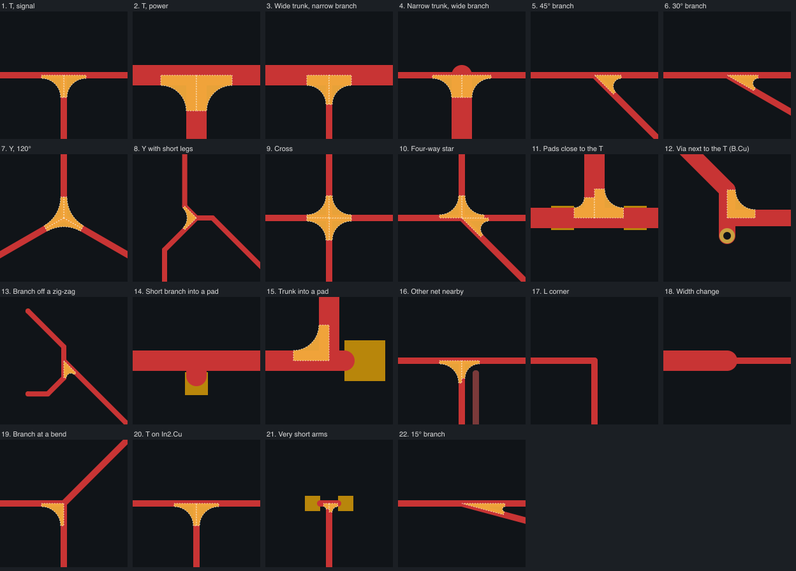

# Contributing

## Layout

| Path | What it is |
|---|---|
| `teardrop_t.py` | The core: junction search, fillet geometry, `add`/`remove`/`plan`/`outdated`, and the self-test. It does not use wx. |
| `mt_teardrop_t/` | The KiCad action plugin: `__init__.py` registers the action, `dialog.py` is the dialog. |
| `package.py` | Builds `dist/mt_teardrop_t-<VERSION>.zip` for the Plugin and Content Manager, with a copy of the core. |
| `test/` | The synthetic test board (`make_board.py`) and the regression (`regression.py`). |
| `docs/` | The README images and `make_images.py`, which renders them. |

## Checks

Run them with KiCad's Python. On macOS it is
`/Applications/KiCad/KiCad.app/Contents/Frameworks/Python.framework/Versions/Current/bin/python3`.

| What | Command |
|---|---|
| Self-test of the core (geometry, scope, filters, out-of-date, clearance) | `python3 teardrop_t.py --selftest` |
| Regression on the test board (needs `kicad-cli`; writes `test/out/`) | `python3 test/regression.py` |
| Render the README images again (opens the dialog for a moment) | `python3 docs/make_images.py` |

## Test board

`test/make_board.py` builds a synthetic board with 22 kinds of junction:

- T junctions of several widths;
- branches at 45°, 30° and 15°;
- Y splits, crosses and a four-way star;
- pads and a via close to the node;
- another net nearby;
- very short arms;
- junctions on F.Cu, B.Cu and In2.Cu;
- three junctions copied from a real board.

Every loose track end gets a pad of its net, so the board itself has a clean DRC.

`test/regression.py` adds the fillets with the default parameters and refills the zones with the `kicad-cli` DRC. It then requires
all of these:

- a clean DRC with no unconnected items;
- the expected number of fillets in each case (`WEDGES` in `make_board.py`);
- every fillet filled over at least 95 % of its outline. A fillet cut by a clearance falls below that.

## Rules

- **A new geometry rule goes in three places at once:**
  - the self-test in `teardrop_t.py`;
  - a case in `test/make_board.py`, with its count in `WEDGES`;
  - a row of the parameter table in the README, with the reason.
- Put a new rule in `plan()` or `corner()`, never in the dialog. What `plan()` decides holds for `add()`, `outdated()` and the
  dialog's count.
- The plugin changes the board only inside `Run()`. KiCad records a plugin's changes, as one undo step that marks the board unsaved,
  only while `Run()` runs. That is why the dialog is modal.
- Documents, comments and commit messages are in English.

## Release

1. Bump `VERSION` in `package.py` and add the changes to `CHANGELOG.md`.
2. Run the self-test and the regression.
3. Run `python3 package.py --submission`. It writes `dist/mt_teardrop_t-<VERSION>.zip`, checks the zip's contents, and writes
   `dist/submission/<identifier>/` with the store metadata (download URL, sha256 and sizes of that zip) and the icon.
4. Install the zip in KiCad with **Plugin and Content Manager → Install from File...** and try it.
5. Tag `v<VERSION>` and create a GitHub release with that same zip attached. Building the zip again changes its sha256.
6. To update the KiCad store, add the new version to `packages/<identifier>/metadata.json` in a fork of
   [kicad/addons/metadata](https://gitlab.com/kicad/addons/metadata) and open a merge request. Older versions stay in that list.
