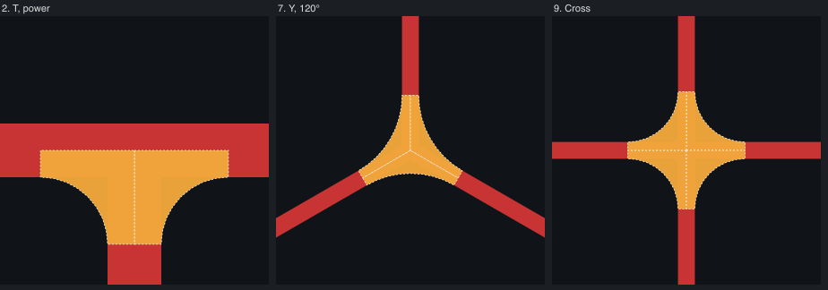
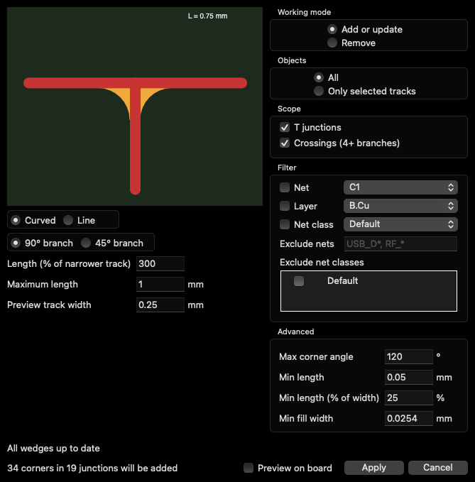
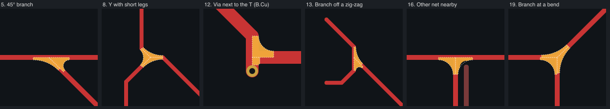
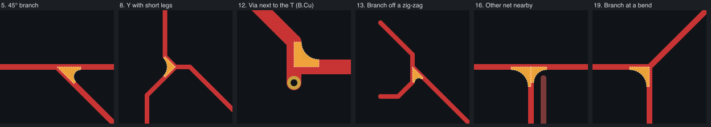

# T-Junction Teardrops

A KiCad action plugin that fills the corners of track T-junctions with copper.



KiCad adds a track-to-track teardrop only where the track width changes. A T between two tracks of the same width gets nothing. This
plugin adds a concave fillet in each corner of every junction where three or more tracks of the same net meet on one layer.

## Install

Build the package and install it from the file:

```bash
python3 package.py
```

1. The package goes to `dist/mt_teardrop_t-<version>.zip`.
2. In KiCad, open **Plugin and Content Manager → Install from File...** and pick the zip.
3. The **T-Junction Teardrops** button shows up on the PCB editor toolbar.

The zip carries its own copy of `teardrop_t.py`. After changing the core, build the zip again and reinstall it.

The plugin uses the SWIG Python API. It was tested on KiCad 10.0 on macOS.

## Use



The dialog previews a sample T with the current parameters, and counts the corners and junctions it will add.

- **Working mode:** *Add or update* (re)makes the fillets in scope. *Remove* deletes them.
- **Objects:** the whole board, or only the junctions that touch the selected tracks.
- **Scope:** T junctions (3 branches) and crossings (4 or more).
- **Filter:** one net, layer or net class.
- **Exclude nets:** comma-separated patterns, such as `USB_D*, RF_*`. Use it where extra copper would change a controlled impedance.
- **Exclude net classes:** pick the classes to skip.
- **Out of date:** a line reports fillets whose tracks moved, got wider, or whose junction is gone. **Update out-of-date** redoes only those.
- **Preview on board:** applies the current settings live. **Cancel** puts the board back.
- **Apply:** makes the fillets, refills the zones, and saves the parameters to `<board>.teardrop_t.json` next to the board.

Each fillet is a zone of its own, named `T-td`, one per corner. It connects fully and has a priority above every other zone, so a
ground pour gives way to it. Its minimum fill width is 0.0254 mm, like KiCad's own teardrops.

The zone covers the corner and the half track beside it. This puts the node inside the fill, so KiCad sees the zone as connected and
fills it up to the tangent points. `T-td` zones are not KiCad teardrop areas, so KiCad does not delete them when it rebuilds its own
teardrops.

## How a fillet is drawn

- **Where the corner starts:** the two track edges that face the corner meet at a point C. The fillet runs from C along each edge for a
  length L. It is closed by an arc tangent to both edges, or by a straight line in *Line* mode.
- **Length:** L = *Length* % of the narrower track, capped by *Maximum length*. L is also cut where either branch ends or bends. Fillets
  of different corners of one junction never overlap.
- **Pads and vias:** a branch stops at the first pad or via of its own net, so a fillet never covers a pad edge. A junction inside a pad
  or via is skipped, because KiCad's own teardrops cover pads and vias.
- **Other nets:** a fillet is shortened until it keeps the clearance to other nets' tracks, pads and vias. Without this, the zone fill
  would cut the fillet and leave a thin copper horn.
- **Too short:** a fillet shorter than *Min length*, or than *Min length (% of width)* of the narrower track, is not made.

| Parameter | Default | Why |
|---|---|---|
| Length (% of narrower track) | 300 % | At 150 % the fillet on a 0.2 mm track was barely visible. |
| Maximum length | 1 mm | Caps the fillet on wide tracks. Without it, a 0.8 mm track would get 2.4 mm. |
| Max corner angle | 120° | Corners of 135° or more neither trap etchant nor concentrate stress. Filling them made blobs: Y splits, zig-zags, a branch at a bend. 120° still covers a hand-routed near-90° and a Y of 120°. The limit is inclusive. |
| Min length | 0.05 mm | Absolute floor. |
| Min length (% of width) | 25 % | A fillet cut short by a pad or via is a step, not a fillet. 50 % gave the same result on the test board, but dropped a useful 0.35 mm fillet on a 0.8 mm track. |
| Min fill width | 0.0254 mm | With a coarser minimum, the fill cut the tips off. |

Here are the junctions where these rules matter. The first row has every corner up to 179°, no minimum length and no clearance check. The second row has the
defaults:




## Command line

The core also runs without the KiCad GUI, with KiCad's Python (on macOS,
`/Applications/KiCad/KiCad.app/Contents/Frameworks/Python.framework/Versions/Current/bin/python3`):

```bash
python3 teardrop_t.py in.kicad_pcb out.kicad_pcb
```

It uses the parameters saved in `in.teardrop_t.json` next to the input board, if there is one, and the defaults otherwise.

## Limits

- Junctions are found among straight track segments only. Arcs are ignored.
- A junction is a set of segment ends that coincide, or a segment end on another segment's axis, within 1 µm.
- The clearance check uses each item's own clearance: its net class, or rules about one item. A `.kicad_dru` rule between two specific
  nets is not seen. The zone fill still enforces it, so there the fillet is cut as before.
- The plugin needs the SWIG Python API. KiCad plans to remove that API, and a version for the new IPC API has not been written.

## Contributing

See [CONTRIBUTING.md](CONTRIBUTING.md) for the test board, the checks and how to build the package.
Changes are listed in [CHANGELOG.md](CHANGELOG.md).

## License

MIT, see [LICENSE](LICENSE).
